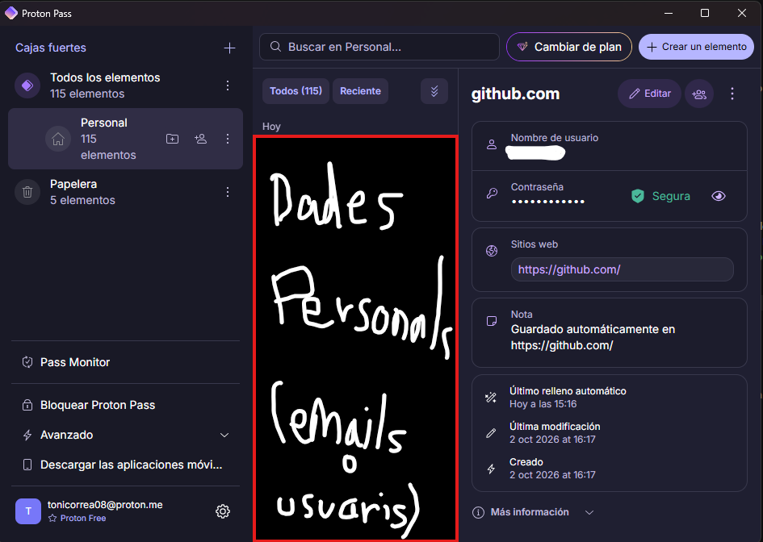
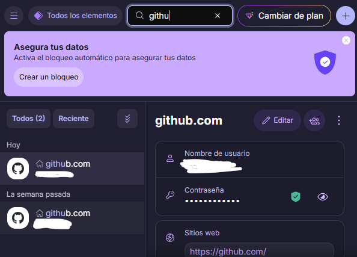
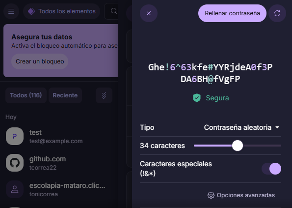
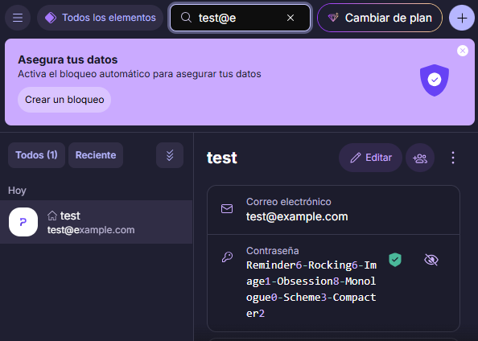
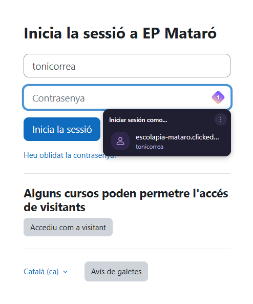
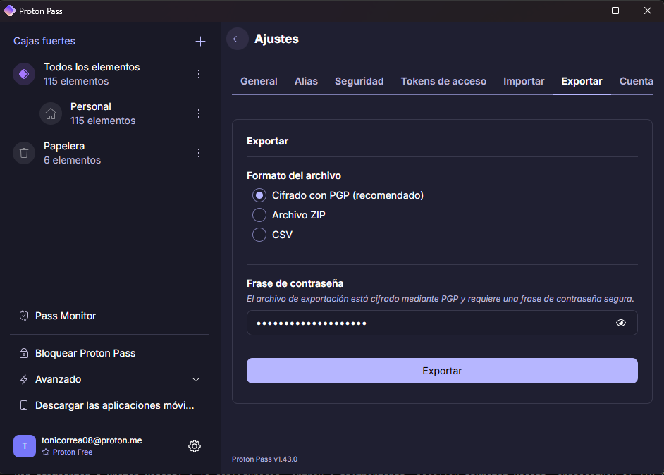
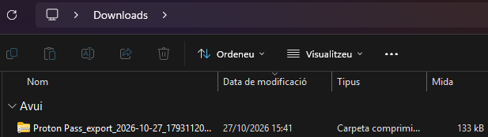

# EverPia — Guia operativa de Proton Pass a Windows 11

| | |
|---|---|
| **Empresa (fictícia)** | EverPia, consultora tecnològica |
| **Eina** | **Proton Pass** (escollida a l'informe de la Fase 1) |
| **Entorn** | Màquina virtual amb Windows 11 |
| **Alumne/a** | Toni Correa |
| **Mòdul** | Seguretat |

---

## 1. Objectiu i requisits previs

### 1.1. Què es farà

En aquesta guia es descriu, pas a pas, com:

1. Instal·lar Proton Pass.
2. Iniciar sessió o crear un compte autoritzat.
3. Protegir el compte.
4. Instal·lar l'extensió del navegador.
5. Generar una contrasenya robusta.
6. Guardar credencials de prova.
7. Comprovar l'autocompletat.
8. Crear una còpia de seguretat xifrada.

> Aquesta guia és un **procediment per seguir**. Les accions les ha de fer l'alumne/a a la seva màquina virtual i afegir-hi les **captures reals** pròpies. Aquest document no afirma que ningú hagi fet les proves.

### 1.2. Requisits previs

- Una màquina virtual amb **Windows 11** i connexió a Internet.
- Un navegador (Chrome, Firefox, Edge, Brave o Safari tenen extensió oficial).
- Un **compte de prova o autoritzat**. No feu servir el compte personal o d'empresa real si no cal.
- Un correu de prova i un servei web de demostració per fer les proves.

### 1.3. Regla important sobre les captures

- Utilitzeu només **dades fictícies o autoritzades**.
- **No** hi ha de sortir cap contrasenya real, ni cap frase de pas, ni el fitxer de còpia de seguretat.
- Si una contrasenya es veu, **tapeu-la** o torneu a fer la captura amb la contrasenya oculta.

---

## 2. Instal·lar Proton Pass a Windows 11

1. Obriu el navegador i aneu a la pàgina oficial de descàrrega: <https://proton.me/pass/download/windows>
2. Baixeu l'aplicació per a Windows des d'aquesta pàgina. No la baixeu des d'altres webs.
3. Executeu l'instal·lador que s'ha descarregat (normalment queda a la carpeta *Baixades*). Si Windows demana permís, comproveu que l'editor sigui Proton i accepteu.
4. Seguiu les instruccions fins que acabi la instal·lació.
5. Obriu l'aplicació **Proton Pass**.
6. **Inicieu sessió** amb el compte Proton o **creeu-ne un de nou** si no en teniu (només amb dades autoritzades).
7. Utilitzeu una **contrasenya de compte llarga i única**, que no feu servir enlloc més.
8. **Activeu la MFA** (verificació en dos passos) al compte Proton. Feu-ho des de la configuració de seguretat del compte, a la web de Proton.

> **Nota sobre la contrasenya.** Proton Pass fa servir el **compte Proton**. Per tant, **no cal una contrasenya mestra independent** com en altres gestors. La contrasenya del compte Proton és la que protegeix l'accés. Si es vol una capa més només per a Pass, Proton ofereix opcionalment una **contrasenya addicional** (*extra password*) que es demana a més de la del compte. És opcional, i si s'oblida no es pot accedir a les dades de Pass: aneu amb compte (vegeu <https://proton.me/support/pass-extra-password>).

---

## 3. Instal·lar l'extensió del navegador

1. Aneu a la pàgina oficial de Proton Pass i escolliu el vostre navegador. Enllaços directes que surten a la pàgina oficial:
   - Chrome: <https://proton.me/pass/download/chrome>
   - Firefox: <https://proton.me/pass/download/firefox>
   - Edge: <https://proton.me/pass/download/edge>
   - Brave: <https://proton.me/pass/download/brave>
   - Safari: <https://proton.me/pass/download/safari>
2. També podeu buscar «Proton Pass» a la **botiga oficial** del navegador. Comproveu que l'editor és **Proton AG**.
3. Premeu el botó per afegir l'extensió i accepteu la instal·lació.
4. Fixeu la icona de l'extensió a la barra d'eines, per tenir-la a mà.
5. Obriu l'extensió i **inicieu sessió** amb el mateix compte Proton.

> **Advertència.** Abans d'acceptar, **reviseu els permisos** que demana l'extensió. I sempre que l'extensió us proposi omplir dades, **comproveu que el domini de la web és el correcte**. Hi ha extensions falses amb noms semblants.

---

## 4. Generar una contrasenya segura

### 4.1. Passos

1. Obriu Proton Pass (aplicació o extensió).
2. Premeu el botó per **crear un element nou** (*Login*). Al camp de contrasenya hi ha l'opció per **generar-ne una**.
3. A les opcions del generador, escolliu el mode **Aleatori** (*Random*).
4. Poseu la **longitud** a **20 caràcters o més** (el valor per defecte que mostra Proton és 16).
5. Activeu **majúscules**, **números** i **símbols**.
6. Premeu **Regenerar** si voleu una altra contrasenya. Comproveu l'indicador de força.
7. Feu servir la contrasenya generada al camp (no cal copiar-la a cap altre lloc).

El generador té, segons la pàgina oficial, el mode **Aleatori** i el mode **Memorable** (frases). El mode memorable és útil quan s'ha d'escriure a mà, per exemple, per a la contrasenya del compte.

### 4.2. Exemple de configuració

| Opció | Valor recomanat |
|---|---|
| Mode | Aleatori |
| Longitud | 20 o més |
| Majúscules | Activat |
| Números | Activat |
| Símbols | Activat |

Si la web de destinació **no accepta alguns símbols** o limita la longitud, cal **adaptar la configuració**: per exemple, treure els símbols i **allargar** la contrasenya per compensar.

### 4.3. Per què importa que sigui llarga i única

- **Llarga**: cada caràcter que s'afegeix multiplica el nombre de combinacions possibles. Així, la força bruta triga molt més.
- **Aleatòria**: no es pot endevinar amb un atac de diccionari.
- **Única**: si només es fa servir en un lloc, una filtració d'aquell servei **no obre els altres comptes** (credential stuffing).

> **No** escriviu a la guia cap contrasenya generada ni la mostreu a les captures.

---

## 5. Guardar credencials de prova

### Inici de sessió d'un correu de prova

1. A Proton Pass, premeu **Nou element** i escolliu **Login**.
2. **Nom de l'element**: per exemple, `Correu de prova`.
3. **Nom d'usuari**: l'adreça fictícia o autoritzada.
4. **Contrasenya**: genereu-la amb el generador (apartat 4).
5. **URL**: la web del servei de correu de prova.
6. Premeu **Desar**.

---

## 6. Comprovar l'autocompletat

1. Obriu el **web de prova**.
2. **Comproveu que el domini és el legítim** (mireu bé l'adreça a la barra del navegador).
3. Obriu l'extensió **Proton Pass**, o feu clic al camp d'usuari.
4. Seleccioneu la **credencial** que correspon.
5. Si està disponible, feu servir l'**autocompletat** perquè ompli l'usuari i la contrasenya.
6. Comproveu que s'ha omplert i que l'inici de sessió funciona, **sense mostrar la contrasenya** (ha d'aparèixer amb punts).

> **Advertència.** L'autocompletat **no elimina tots els riscos de phishing**. Una web falsa amb un domini molt semblant pot enganyar una persona, així que cal mirar sempre l'adreça abans d'omplir res. Si el gestor no ofereix omplir dades en una web que esperàveu que sí, **desconfieu**.

---

## 7. Crear una còpia de seguretat xifrada

Aquest apartat segueix la documentació oficial de Proton (<https://proton.me/support/pass-export>). Els noms dels botons poden canviar amb les versions, per això **cal comprovar-ho a la vostra pantalla**.

### 7.1. Passos

1. Obriu **Proton Pass** a Windows.
2. Obriu el **menú de configuració**: segons la documentació oficial, es troba al menú de les tres ratlles (☰) de l'aplicació de Windows.
3. Entreu a la pestanya **Exportar** (*Export*).
4. Escolliu el format **ZIP xifrat amb PGP** (*PGP-encrypted ZIP*). Conté un fitxer JSON xifrat. Les altres opcions són ZIP sense xifrar i CSV, i **no s'han de fer servir per a una còpia habitual**.
5. Escriviu una **frase de pas** (*passphrase*) **forta** per a l'exportació. La documentació demana una frase que es pugui recordar i no fixa una longitud mínima. Nosaltres recomanem que sigui **llarga i única**, per exemple de 4 o més paraules sense relació entre elles. Podeu fer servir el generador en mode memorable.
6. **Deseu la frase de pas en un lloc segur i separat del fitxer.** Millor que no sigui només dins del mateix Proton Pass, perquè si perdeu l'accés al compte tampoc no podríeu obrir la còpia. Una opció és un lloc aprovat per l'empresa o un paper guardat sota clau.
7. Premeu **Exportar**. El fitxer es descarrega a la carpeta de descàrregues per defecte.
8. **Localitzeu el fitxer** (normalment a *Baixades*).
9. **Moveu-lo immediatament** a un **USB xifrat** o a un **emmagatzematge corporatiu aprovat**, amb accés restringit. Elimineu la còpia de *Baixades*.

### 7.2. Comprovar que el fitxer s'ha desat bé

- Comproveu que el fitxer **existeix** al lloc final i que té una **mida raonable** (no 0 KB).
- Comproveu la **data** i el **nom** del fitxer.
- Si voleu estar segurs que es pot restaurar, feu una **prova d'importació** en un compte de prova **que no sigui el compte real**.

### 7.3. Precaucions en restaurar

- **Importar** el fitxer de nou a Proton Pass i **desxifrar-lo per fer-lo servir fora** són coses diferents.
- Per **importar a Proton Pass**: a la configuració, entreu a **Importar**, escolliu **Proton Pass**, arrossegueu el ZIP (xifrat o no) i, si està xifrat, escriviu la frase de pas. **No cal desxifrar-lo abans**.
- Per **desxifrar-lo fora de Proton Pass** (per exemple, per importar-lo a un altre gestor), segons la documentació oficial a Windows s'ha d'instal·lar **GPG4Win**, extreure el ZIP, obrir `data.pgp` i triar *Decrypt and verify*. El resultat és un **JSON en text pla**: qualsevol persona amb accés a aquest fitxer pot llegir totes les credencials.
- Per tant, **esborreu el fitxer desxifrat** quan acabeu, i no el deixeu a *Baixades*, a l'escriptori ni a un USB sense protecció.
- Sense la frase de pas la còpia probablement no serveix de res. La documentació oficial no explica cap manera de recuperar-la, així que no la perdeu.

### 7.4. Advertències

- **No** feu servir **CSV** ni exportacions **sense xifrar** com a còpia habitual.
- **No** deixeu fitxers exportats sense xifrar a *Baixades*, a l'escriptori ni en un **USB sense protecció**.
- **No** guardeu la **frase de pas** al costat del fitxer de còpia.
- **No** pugeu credencials a serveis personals no autoritzats.
- **No** incloeu el fitxer de còpia ni la frase de pas a les **captures** de l'informe.
- Recordeu que l'exportació **no es pot fer des de les apps mòbils**, només des de l'extensió, la web o l'aplicació de Windows.

---

## 8. Bones pràctiques

- Feu servir **contrasenyes úniques** a cada servei.
- **Activeu la MFA** a tots els comptes que ho permetin, també al compte Proton.
- **Bloqueu l'equip** (tecles Windows + L) quan us n'allunyeu.
- Mantingueu **Windows i el navegador actualitzats**.
- **Verifiqueu els dominis** abans d'introduir credencials.
- **Protegiu les còpies de seguretat**: xifrades, en un lloc aprovat i amb accés restringit.
- **Reviseu les credencials dèbils o reutilitzades**. Proton Pass té comprovacions de salut de les contrasenyes que avisen de contrasenyes febles, reutilitzades o sense 2FA.
- Si treballeu amb **comptes corporatius**, seguiu sempre les **polítiques de TI** de l'empresa.

---

## 9. Llista de comprovació final

- [ ] Aplicació instal·lada
- [ ] Compte configurat
- [ ] MFA activada
- [ ] Extensió instal·lada
- [ ] Generador provat
- [ ] Dues credencials de prova desades
- [ ] Autocompletat comprovat
- [ ] Còpia de seguretat xifrada creada
- [ ] Captures reals afegides
- [ ] Cap secret exposat a les captures

---

## 10. Fonts oficials

- Descàrrega de Proton Pass per a Windows: <https://proton.me/pass/download/windows>
- Exportar i importar dades: <https://proton.me/support/pass-export>
- Seguretat de Proton Pass: <https://proton.me/pass/security>
- Contrasenya addicional (*extra password*): <https://proton.me/support/pass-extra-password>
- Generador de contrasenyes: <https://proton.me/pass/password-generator>
- Extensions de navegador (des de la pàgina de descàrrega): <https://proton.me/pass/download/windows>
- CISA, *Use Strong Passwords*: <https://www.cisa.gov/secure-our-world/use-strong-passwords> (no s'ha pogut obrir en el moment de redactar la guia; llegiu-la abans de citar-la)
